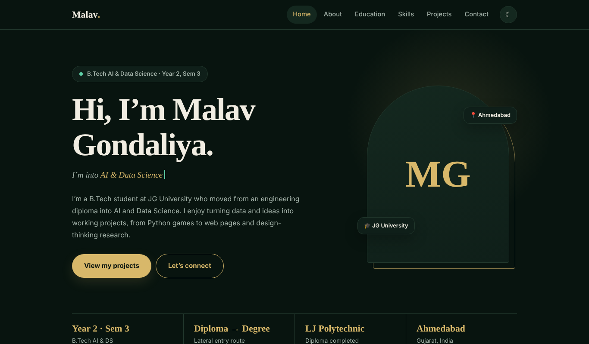

# Malav Gondaliya | Portfolio

My personal portfolio website. I am a B.Tech AI & Data Science student (Year 2, Semester 3) at JG University, Ahmedabad. Roll No. 267708.

## Sections
Home, About, Education, Skills, Projects and Contact.

## Features
- Dark and light mode
- Mobile menu that opens and closes
- Contact form validation with error messages and a character counter
- Project filter by category
- Scroll animations, progress bar and back-to-top button
- Responsive layout for mobile and laptop screens

## Technologies used
- HTML5
- CSS3 (Flexbox, Grid, media queries)
- JavaScript (no frameworks)
- Google Fonts (Fraunces and Manrope)

## How to run
Download the files and open `index.html` in a web browser.
